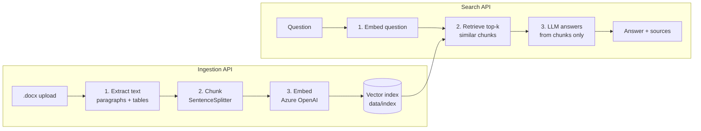

# RAG POC – Document Ingestion & Search

A minimal RAG (Retrieval-Augmented Generation) pipeline with two APIs:

| API | Purpose |
|-----|---------|
| `POST /ingest` | Upload a Word document (`.docx`). It is parsed, chunked, embedded and stored. |
| `POST /search` | Ask a question. Relevant chunks are retrieved and the LLM answers from them only. |

## Pipeline



| File | What it shows |
|------|---------------|
| [app/ingestion.py](app/ingestion.py) | Load → chunk → embed/store |
| [app/search.py](app/search.py) | Retrieve → generate (prompt grounded in context) |
| [app/vector_store.py](app/vector_store.py) | Persisting/loading the vector index |
| [app/config.py](app/config.py) | Azure OpenAI embedding model + LLM setup |
| [app/main.py](app/main.py) | FastAPI endpoints |

## Run

```powershell
cd poc
python -m venv .venv
.\.venv\Scripts\Activate.ps1
pip install -r requirements.txt
Copy-Item .env.example .env   # then fill in AZURE_KEY / AZURE_ENDPOINT
uvicorn app.main:app --reload
```

Open http://127.0.0.1:8000/docs to try the APIs.

## Examples

```powershell
curl.exe -F "file=@C:\path\to\policy.docx" http://127.0.0.1:8000/ingest
# {"document_id":"...","file_name":"policy.docx","characters":15230,"chunks":9}

curl.exe -X POST http://127.0.0.1:8000/search -H "Content-Type: application/json" `
  -d '{\"question\": \"What is the cancellation period?\", \"top_k\": 4}'
# {"answer":"...","sources":[{"file_name":"policy.docx","score":0.87,"text":"..."}]}
```

Pass `document_id` in the search body to restrict the search to one document.
To start fresh, delete the `data/index` folder.
